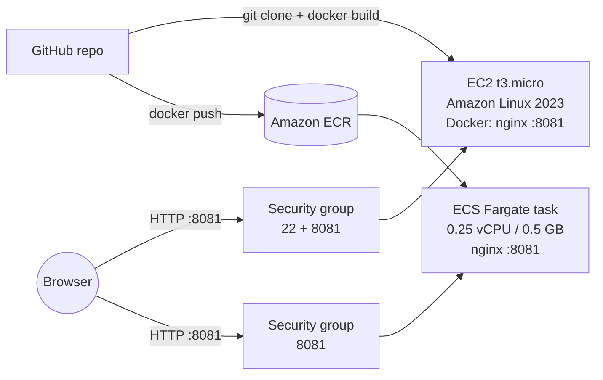

# hello-nginx-docker-aws

A static "Hello World" page served by Nginx inside a Docker container on port **8081**, deployed to AWS two ways: on a single **EC2** instance, and on **ECS Fargate** with the same image.

[](https://github.com/Gonugunta-Venkata-Jayanth/hello-nginx-docker-aws/actions/workflows/ci.yml)
[](LICENSE)


## Overview

I built this to show the full path from code to a public URL: write a small app, containerize it, provision a server, open only the ports it needs, and run it so anyone can reach `http://<server-ip>:8081`. I then ran the same image on ECS Fargate, which is closer to how a production team would run it, since ECS restarts failed containers and can scale them.

## Architecture



## Repository layout

| Path | Purpose |
|---|---|
| `app/index.html` | The Hello World page |
| `nginx.conf` | Nginx site listening on 8081, plus a `/health` endpoint |
| `Dockerfile` | Builds the image from `nginx:1.27-alpine` |
| `scripts/ec2-setup.sh` | Installs Docker on a fresh EC2 instance, then builds and runs the app |
| `ecs/task-definition.json` | Fargate task definition for the same image |
| `ecs/deploy-ecs.sh` | Pushes to ECR and creates the ECS cluster and service |
| `scripts/teardown.sh` | Deletes the ECS resources (and optionally the EC2 instance) so nothing keeps billing |
| `.github/workflows/ci.yml` | Lints the scripts, builds the image, and checks the page on 8081 |

## Design choices

**Instance: t3.micro, Amazon Linux 2023, 8 GiB gp3.** It has 2 vCPUs (burstable) and 1 GiB of RAM, which is far more than a static Nginx container needs (it uses a few MB). It is free-tier eligible, so the test costs nothing. Amazon Linux 2023 ships Docker in its own package repository, so setup is one `dnf install`.

**Port 8081.** The task asks for it. Using a non-default port also shows that the container port, the host port mapping (`-p 8081:8081`) and the security group rule all have to agree.

**Nginx on Alpine.** Serving static files is exactly what Nginx is built for. The Alpine image is around 20 MB, so builds and pulls are fast, and there is less in the image to patch.

**Security group.** Port 22 is open for SSH so I can administer the instance; in practice it should be limited to my own IP. Port 8081 is open to `0.0.0.0/0` because the app must be reachable by anyone. Nothing else is open.

**ECS Fargate.** Fargate runs the container without me managing servers. The service keeps one task running and replaces it if the health check fails. The smallest size (0.25 vCPU, 0.5 GB) is enough here.

## Run locally

```bash
docker build -t hello-nginx .
docker run -d -p 8081:8081 --name hello-nginx hello-nginx
curl http://localhost:8081/health   # ok
```

Then open http://localhost:8081.

## Deploy on EC2

1. Launch an instance: Amazon Linux 2023, `t3.micro`, 8 GiB gp3, a key pair, and a security group allowing TCP 22 (my IP) and TCP 8081 (anywhere).
2. SSH in and run the setup script:

   ```bash
   ssh -i my-key.pem ec2-user@<public-ip>
   curl -fsSL https://raw.githubusercontent.com/Gonugunta-Venkata-Jayanth/hello-nginx-docker-aws/main/scripts/ec2-setup.sh | sudo bash
   ```

   The script installs Docker and Git, starts Docker, verifies it with `hello-world`, clones this repo, builds the image, and runs it on 8081 with `--restart unless-stopped`. The same script also works as EC2 user data at launch.
3. Open `http://<public-ip>:8081`.

## Deploy on ECS Fargate

With the AWS CLI configured for an IAM user (not root):

```bash
AWS_REGION=ap-south-1 ./ecs/deploy-ecs.sh
```

The script creates an ECR repository and pushes the image, creates the `ecsTaskExecutionRole` if it is missing, registers the task definition, and starts a Fargate service in the default VPC with a public IP and a security group open on 8081. It prints the task's public URL when the service is stable.

## Cost and cleanup

EC2 `t3.micro` is free-tier eligible. Fargate is not free: at this size it costs roughly a cent or two per hour, plus a small charge for the public IPv4 address, so I run it only while testing. To remove everything:

```bash
INSTANCE_ID=i-xxxxxxxx AWS_REGION=ap-south-1 ./scripts/teardown.sh
```

This scales the service to 0, deletes the service, cluster, ECR repository, log group and security group, and terminates the EC2 instance (its root volume is deleted with it).

## Tooling

I used AI assistance (Claude) to draft the setup, deploy and teardown scripts, then reviewed and tested each one before using it.

## License

[MIT](LICENSE)
